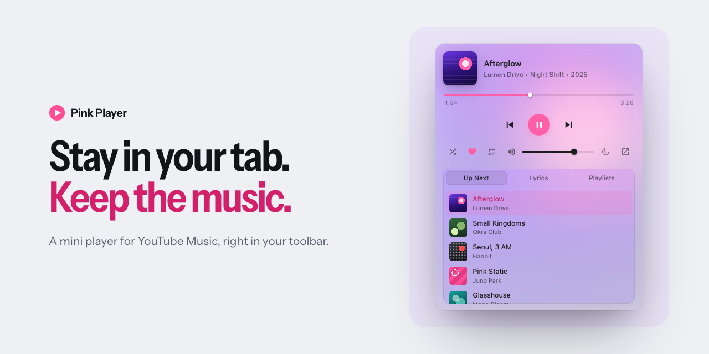
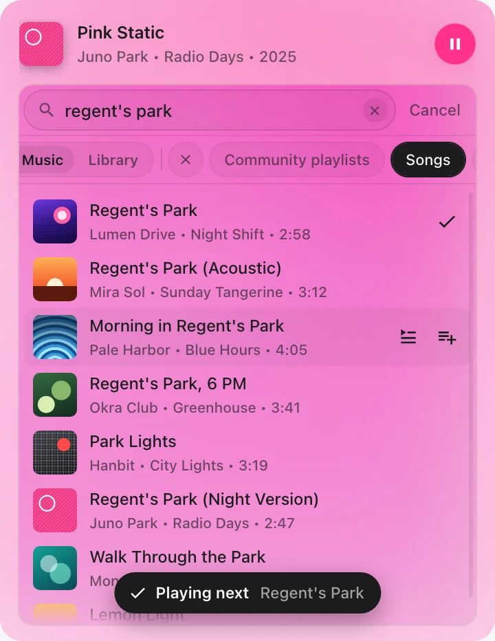
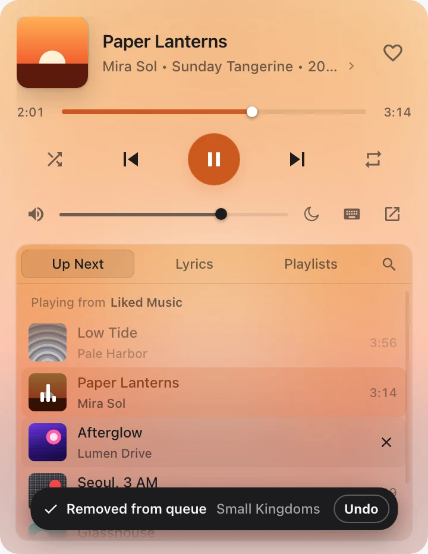
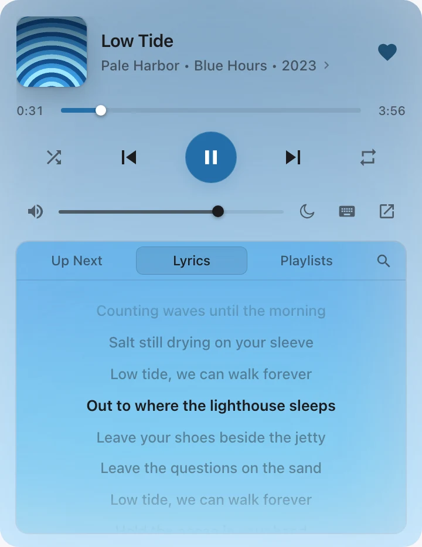
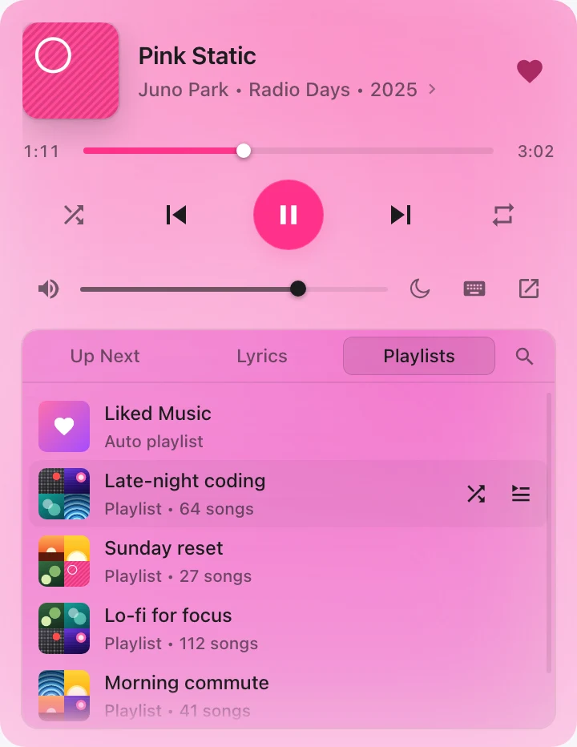
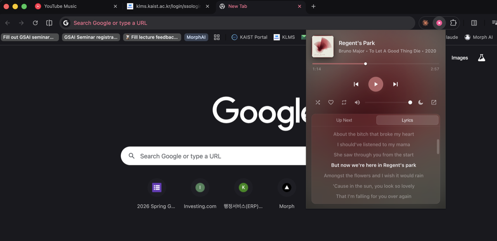
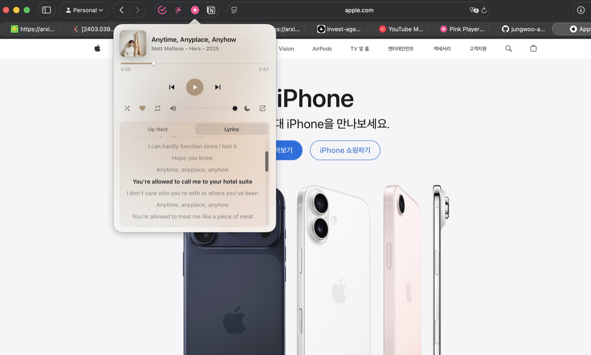

# Pink Player

A mini player for **YouTube Music** that drops down from your browser toolbar, in Chrome, Edge and Safari. Search and queue songs, follow synced lyrics and control playback from any tab. No tracking, no ads.

## Get it

| 🌐 [Pink Player site](https://jungwoo-ahn.github.io/pink-player-site/) | 🟢 [Add to Chrome](https://chromewebstore.google.com/detail/pink-player-%E2%80%94-mini-for-yo/aaikooaeajlfemfgfmembjkpbppmfloo) | 🍎 [Mac App Store](https://apps.apple.com/app/id6823947078) |
| :---: | :---: | :---: |
| With a live demo of the popup | Chrome and Edge | Safari on Mac |

## Features

| Search | Up Next | Lyrics | Playlists |
| :---: | :---: | :---: | :---: |
|  |  |  |  |
| Suggestions as you type, YouTube Music's own filters, and Play now, Play next or Add to queue. | What you're playing from, what just played and what's next. Remove a song and undo it. | Synced lyrics that follow the song. Tap a line to jump there. | Every playlist in your library. Pro in Chrome; included in the Mac app. |

Plus adaptive color from the album art, a sleep timer, keyboard shortcuts, a pop-out window, and light and dark mode.

## Out in the wild

**Chrome**

**Safari**

## What's in this repo

This is the **public landing page** for Pink Player, served at [jungwoo-ahn.github.io/pink-player-site](https://jungwoo-ahn.github.io/pink-player-site/).

- [`index.html`](./index.html): the landing page
- [`privacy.html`](./privacy.html) and [`terms.html`](./terms.html): privacy policy and Pink Player Pro terms
- [`demo/`](./demo): the live demo on the landing page. `popup.html`, `popup.css`, `popup.js` and `lyrics.js` are the extension's own popup, unchanged. `demo.js` stands in for the browser and YouTube Music with made-up songs.
- [`assets/`](./assets) and [`screenshots/`](./screenshots): styles and images for the page and this README

The extension source code lives in a separate, private repo.

---

[Privacy](./privacy.html) · [Terms](./terms.html) · Unofficial third-party tool. Not affiliated with or endorsed by YouTube or Google.
